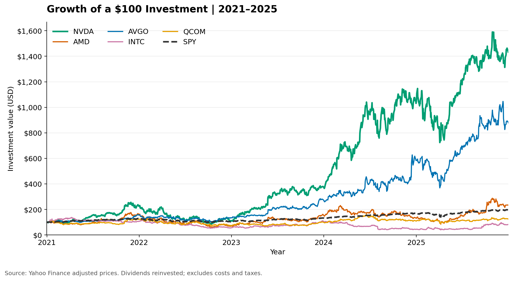
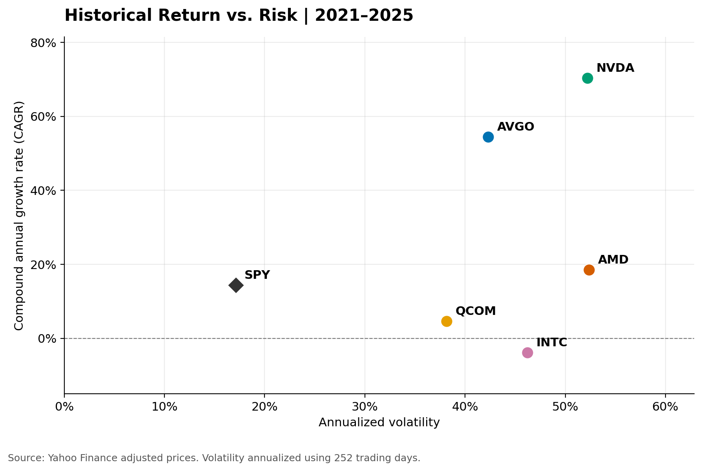
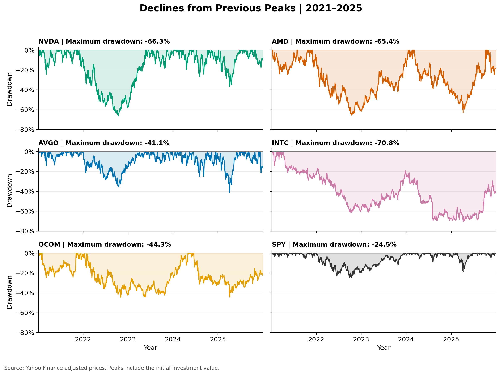
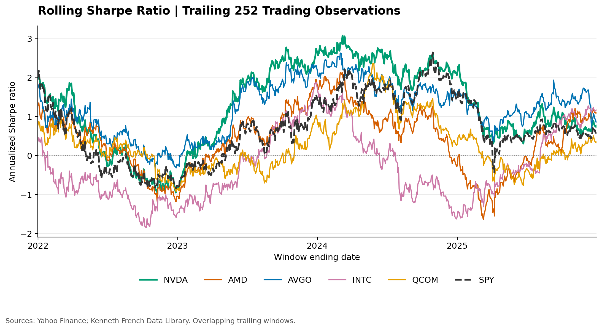

# NVIDIA vs. Semiconductor Peers: Risk and Return Analysis

This Python project compares NVIDIA with AMD, Broadcom, Intel, and Qualcomm from January 2021 through December 2025. It examines whether NVIDIA's historical growth was accompanied by stronger risk-adjusted performance and how the conclusions change across years and benchmarks.

**Main finding:** NVIDIA delivered the highest full-period CAGR and Sharpe ratio in this sample, but experienced a 66.34% maximum drawdown. Broadcom achieved a similar Sharpe ratio with lower volatility and a smaller drawdown. These results support further comparative research; they do not establish which stock is currently undervalued.

[View the analysis notebook](NVIDIA_Peer_Risk_Return_Analysis.ipynb)

## Key results

| Asset | CAGR | Annualized volatility | Sharpe ratio | Maximum drawdown | Beta vs. SPY |
| --- | ---: | ---: | ---: | ---: | ---: |
| NVIDIA (NVDA) | 70.30% | 52.20% | 1.22 | -66.34% | 2.13 |
| Broadcom (AVGO) | 54.44% | 42.32% | 1.16 | -41.15% | 1.61 |
| AMD | 18.49% | 52.38% | 0.52 | -65.45% | 2.01 |
| Qualcomm (QCOM) | 4.57% | 38.15% | 0.22 | -44.29% | 1.56 |
| Intel (INTC) | -3.91% | 46.22% | 0.07 | -70.80% | 1.43 |
| S&P 500 ETF (SPY) | 14.34% | 17.12% | 0.68 | -24.50% | 1.00 |

- NVIDIA had the highest annual Sharpe ratio among the five stocks in three of five years. Broadcom led in 2022 and Intel in 2025.
- NVIDIA's beta was 2.13 against SPY and 1.19 against the semiconductor ETF SOXX. Its annualized tracking error was 42.07% and 31.16%, respectively, demonstrating benchmark sensitivity.
- A hypothetical $100 investment in NVIDIA grew to $1,432.59, compared with $878.66 for Broadcom and $195.39 for SPY, using adjusted-price returns before investor taxes and transaction costs.

Sharpe ratios use arithmetic excess returns, while CAGR measures compounded growth. A positive Sharpe ratio can therefore coexist with a negative CAGR, as it does for Intel in this sample.

## Data and methodology

- **Prices:** Yahoo Finance adjusted closing prices retrieved through `yfinance`, accounting for splits and dividends through the provider's adjustments.
- **Risk-free proxy:** Daily RF series from the [Kenneth R. French Data Library](https://mba.tuck.dartmouth.edu/pages/faculty/ken.french/data_library.html), converted from percentage units to decimals and aligned to trading dates.
- **Sample:** 1,255 daily return observations, January 4, 2021–December 31, 2025. A December 31, 2020 price baseline captures the first return of 2021. The download end date, January 1, 2026, is exclusive.
- **Benchmarks:** SPY for broad-market comparison and SOXX for sector sensitivity. SOXX is used for the additional beta and tracking-error comparison.
- **Annualization:** 252 trading days for volatility, Sharpe ratios, and tracking error; five calendar years for full-period CAGR.

| Measure | Calculation |
| --- | --- |
| Daily return | Adjusted price divided by the previous adjusted price, minus one |
| Total return | Product of daily growth factors, minus one |
| CAGR | Final wealth multiple raised to 1/5, minus one |
| Annualized volatility | Sample standard deviation of daily returns × √252 |
| Sharpe ratio | Mean daily excess return ÷ sample standard deviation of daily excess returns × √252 |
| Beta | Covariance of stock and benchmark excess returns ÷ variance of benchmark excess returns |
| Tracking error | Sample standard deviation of stock-minus-benchmark daily returns × √252 |
| Maximum drawdown | Largest percentage decline from the running wealth peak, including the initial investment |

The notebook also compares calendar-year results and 252-trading-day rolling Sharpe ratios. Changing the equity benchmark affects beta and tracking error; it does not change the risk-free-based Sharpe ratio used here.

## Validation and analytical skills

The workflow demonstrates data retrieval, time-series alignment, financial calculations, visualization, and interpretation in Python using pandas, NumPy, and Matplotlib.

Checks cover missing and duplicate observations, nonpositive prices, finite returns, risk-free-date alignment, and a manually verified first return. Compounded returns are reconciled with adjusted-price endpoints. Benchmark self-checks verify beta of one and tracking error of zero; the final rolling Sharpe estimate is reconciled with a direct calculation over the same window.

## Project files

| Path | Contents |
| --- | --- |
| `NVIDIA_Peer_Risk_Return_Analysis.ipynb` | Analysis, saved outputs, charts, findings, and export cells |
| `figures/` | Four exported PNG charts |
| `results/` | Six CSV tables covering full-period results, annual comparisons, benchmarks, and ending investment values |
| `requirements.txt` | Recorded versions of the main packages used |
| `analysis_metadata.json` | Study settings, retrieval timestamps, Python version, and package versions |

Percentage-based measures in the CSV files are decimals: `0.7030` represents approximately 70.30%. Sharpe ratios and betas are unitless; ending investment values are dollar amounts.

## Running the notebook

The notebook was developed in Google Colab.

1. Download `NVIDIA_Peer_Risk_Return_Analysis.ipynb` and open it in Google Colab.
2. Connect to a runtime and run the cells from top to bottom. Internet access is required to download prices and the risk-free series.
3. Review the validation outputs before interpreting the results.
4. The final cells export charts, tables, and environment metadata into a `nvidia-peer-analysis` folder, create a ZIP archive, and download it through Colab.

The export ZIP created by the notebook contains analysis outputs and metadata; it does not automatically include this README or the notebook itself.

For local Jupyter use, install the packages in `requirements.txt` in a compatible Python environment and install Jupyter separately. Skip the final cell that imports `google.colab` and downloads the archive; the other export cells save files locally. The recorded requirements describe the analysis environment rather than a complete dependency lockfile.

Saved outputs document the submitted analysis. A fresh download may produce different results because providers can revise adjusted prices and factor data, and Colab's environment can change. Raw source data are not bundled with this project.

## Limitations

- The five-year period and retrospectively selected stocks limit generalization and may introduce selection and survivorship bias. The companies also have different business mixes.
- Historical returns do not establish future performance. The analysis does not assess valuation, earnings expectations, or company fundamentals.
- The Sharpe difference between NVIDIA and Broadcom is descriptive; no confidence intervals or significance tests establish that it is statistically meaningful.
- Beta and tracking error depend on benchmark selection. SOXX overlaps with the selected stocks, and its holdings and weights can change.
- Risk-free proxy choice, rounded daily RF observations, and square-root-of-time annualization affect estimates. Rolling windows overlap and are not independent observations.
- Investor taxes and transaction costs are excluded. ETF market-price returns reflect fund-level effects, including embedded expenses.

The project is a historical comparison for financial analysis and portfolio research, not a forecast or personalized investment recommendation.
